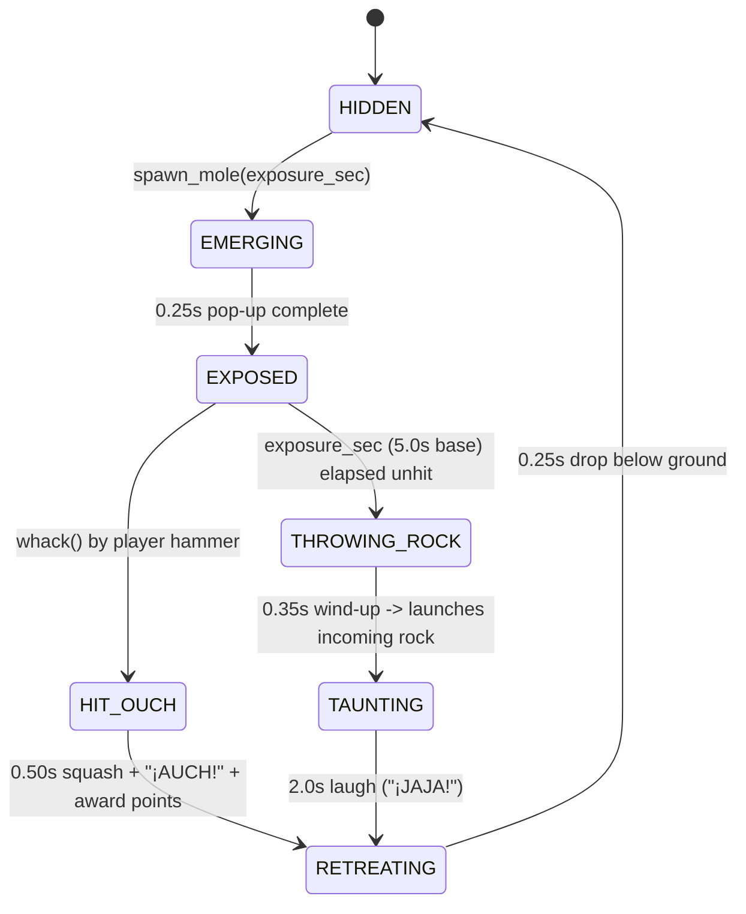
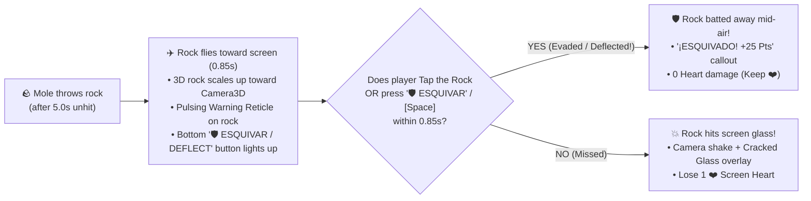

# Step 2: Spec-Driven Technical Specification — Milestone 2 (2.5D Arena, Mole Mechanics & Rock Evasion)

> [!IMPORTANT]
> **Strict 3-Step Workflow (`1. Plan` [Approved] → `2. Spec-Driven` [Current] → `3. Implementation`) & Git Rule**
> This document is the standalone **Step 2: Spec-Driven Specification** for Milestone 2, including your **Rock Evasion / Mid-Air Deflection mechanic** so the playeralways has a skill-based way to avoid losing a Heart when a mole throws a rock.
> No project code has been modified yet. Once you approve `specs.md`, I will save a copy to `docs/specs/milestone_2_spec.md` and execute **Step 3 (Implementation)** without running any Git commits or pushes.

---

## 1. Specification Overview & Subsystem IDs

| Spec ID | Subsystem | Responsibility |
| :--- | :--- | :--- |
| **SPEC-M2-01** | **2.5D Backyard Diorama (`Arena25D`)** | `Camera3D` (48° angle, `KEEP_HEIGHT`), sunlight & sky environment, 3×3 Hole Matrix with PvZ 1-to-3 lane rollout, intro mole walk-in director, 45s round timer, and 3 Screen-Glass Hearts (`❤️❤️❤️`). |
| **SPEC-M2-02** | **3D Hole & Lane Barricade (`Hole3D`)** | Procedural 3D dirt mound rim, dark inner shaft, `Area3D` raycast tap collider, and rolled-turf/wooden plank cover when the lane is locked. |
| **SPEC-M2-03** | **3D Hard-Hat Mole (`Mole3D`)** | Pure-Godot 3D composite character (`MeshInstance3D` capsule body, snout, white grin, aviator sunglasses, yellow hard hat) with 7-state lifecycle: `HIDDEN`, `WALK_IN`, `EMERGING`, `EXPOSED` (`5.0s` base), `THROWING_ROCK`, `TAUNTING` (`2.0s`), `HIT_OUCH`, `RETREATING`. |
| **SPEC-M2-04** | **Interactive Rock Evasion / Deflection (`FlyingRock`)** | When a mole goes unhit for `5.0s`, it throws a rock that flies toward the screen over `0.85s`. The player can **evade/deflect the rock** either by **tapping/clicking the incoming rock reticle directly** OR by pressing the big **🛡️ EVADE / DEFLECT button** (`[Space]` / Gamepad `(B)` / Touch Shield button) during the flight window! |
| **SPEC-M2-05** | **Basic 1-Head 3D Hammer (`Hammer3D`)** | Procedural 3D wooden/iron mallet that swings down onto the tapped hole (`0.14s` arc) with a shockwave ring and triggers `"¡AUCH!"` on the mole. |
| **SPEC-M2-06** | **Big-Text 2D Arcade HUD & Modals** | High-contrast top HUD (`⏱️ 45s`, `❤️❤️❤️`, `🏆 Score`), incoming rock warning indicator, cracked-glass screen overlays (Stages 1, 2, 3), floating `"¡AUCH!"` / `"¡JAJA!"` / `"🛡️ ¡ESQUIVADO!"` callouts, and Victory / Defeat modals. |

---

## 2. Detailed Subsystem Specifications

### SPEC-M2-01: 2.5D Camera, Coordinate Grid & PvZ Lane Rollout

#### A. 3D World & Camera Framing (`res://scenes/game/arena_2_5d.tscn`)
- **`Camera3D` Transform:**
  - Position: `Vector3(0.0, 9.2, 8.8)`
  - Rotation (degrees): `Vector3(-48.0, 0.0, 0.0)`
  - Projection: Perspective, `fov = 42.0`, `keep_aspect = Camera3D.KEEP_HEIGHT`
  - **Why `KEEP_HEIGHT`:** On Mobile Portrait (`1080×1920`), the 3×3 lawn (`X: -3.2 .. +3.2`, `Z: -2.6 .. +2.6`) fills the central screen width snugly. On PC/Console Widescreen (`16:9`), the vertical framing stays identical while the left and right wings reveal extra 3D backyard grass, fences, and bushes!

#### B. 3×3 Matrix Coordinates & PvZ Lane Mapping
The 9 holes are indexed `0..8` (`row = index / 3`, `col = index % 3`):
- **Row 0 (Back Lane, `Z = -2.4`):** Holes `0, 1, 2` at `X = -2.3, 0.0, +2.3` *(Unlocks at Stage 6+ / 3 Lanes)*
- **Row 1 (Center Training Lane, `Z = 0.0`):** Holes `3, 4, 5` at `X = -2.3, 0.0, +2.3` *(Active from Stage 1 / 1 Lane)*
- **Row 2 (Front Lane, `Z = +2.4`):** Holes `6, 7, 8` at `X = -2.3, 0.0, +2.3` *(Unlocks at Stage 3–5 / 2 Lanes)*

#### C. Intro Walk-In Sequence (`2.2` seconds before round timer starts)
- *"El primer topo llega de fuera de la pantalla y se mete al agujero más cercano."*
- On match start (`STATE_INTRO`):
  1. Target hole = Hole `#3` (Leftmost hole of the active Center Training Lane, at `Vector3(-2.3, 0.0, 0.0)`).
  2. An intro `Mole3D` starts off-screen left at `Vector3(-6.8, 0.0, 0.0)`, facing right (`rotation.y = PI * 0.5`).
  3. Over `1.4s`, the mole runs across the lawn with a bouncy vertical hop cycle to `Vector3(-2.3, 0.0, 0.0)`.
  4. Over `0.5s`, the mole leaps into a high arc (`Y = +1.4`) and dives head-first down into Hole `#3` (`Y = -1.3`).
  5. Big banner flashes `"🔨 ¡A GOLPEAR! / SMASH!"` and transitions to `STATE_PLAYING` (`45.0s` timer starts).

---

### SPEC-M2-02 & 03: `Hole3D` and Basic Hard-Hat `Mole3D` State Machine

#### A. `Mole3D` State Timings & Rules
1. **`HIDDEN`:** Mole root at `position.y = -1.35`, `visible = false`, cannot be hit.
2. **`EMERGING` (`0.25s`):** Tweens `position.y` from `-1.35` to `0.0` (`TRANS_BACK`, `EASE_OUT`). Vulnerable to hammer strikes as soon as `position.y > -0.6`.
3. **`EXPOSED` (`exposure_sec = GameManager.get_current_mole_exposure_seconds()`, `5.0s` at Rank 1):**
   - Mole bobs gently and displays a clean 2D/3D exposure progress bar above the hole.
   - **If struck (`whack()`):** Cancels exposure timer, transitions immediately to `HIT_OUCH`.
   - **If timer reaches `0.0s`:** Transitions to `THROWING_ROCK`.
4. **`THROWING_ROCK` (`0.35s`):**
   - Mole becomes invulnerable (too late to whack the mole itself—now you must evade/deflect its rock!), winds up its arm, and emits `rock_thrown(hole_index: int, start_world_pos: Vector3)`.
   - Transitions immediately into `TAUNTING`.
5. **`TAUNTING` (`2.0s`):**
   - *"2 segundos más para burlarse y se esconde."*
   - Mole bounces up and down laughing (`"¡JAJA!"` callout) for `2.0` seconds, then transitions to `RETREATING`.
6. **`HIT_OUCH` (`0.50s`):**
   - *"Si el jugador golpea el topo, se anima un Auch y se esconde dentro del hoyo, al golpear el topo el jugador recibe puntos."*
   - Squashes vertically (`scale = Vector3(1.35, 0.55, 1.35)`), tilts hard hat askew, emits `mole_whacked(hole_index: int, world_pos: Vector3)` (awarding `+100 Points` and `+15 Coins`), spawns `"💥 ¡AUCH!"` floating banner, and transitions to `RETREATING`.
7. **`RETREATING` (`0.25s`):**
   - Tweens `position.y` back to `-1.35` and returns to `HIDDEN`.

---

### SPEC-M2-04: Interactive Rock Evasion / Mid-Air Deflection Mechanic

To ensure the player is never helpless when a mole throws a rock, every thrown rock creates an interactive **`0.85`-second Evasion / Deflection Window**:

1. **Two Ways to Evade / Deflect Any Incoming Rock (Mobile + PC/Console Friendly):**
   - **Method 1 (Direct Tap / Click on the Flying Rock):** A big, pulsing `190×190px` screen-space **🪨🎯 Target Button** tracks the 3D flying rock as it arcs toward the screen. Tapping or clicking the flying rock smashes it out of the air!
   - **Method 2 (Dedicated `🛡️ ESQUIVAR / EVADE` Action Button):** At the bottom of the Arena HUD, a big **`🛡️ ESQUIVAR ROCA / EVADE ROCK`** button (`140px` tall, `44px` font, also bound to Keyboard `[Space]` and Gamepad `(B)` / `(X)`) highlights in bright cyan/gold whenever a rock is in flight. Pressing it deflects/dodges the incoming rock!
   - **Anti-Spam Cooldown on Evade Button:** If pressed when no rock is in flight (or after deflecting), the Evade button has a short `0.6s` recovery so the player still times their dodge when a rock is thrown.

---

### SPEC-M2-05 & 06: Big-Text 2D Arcade HUD & Round End Summary

All Arena HUD elements follow our **Milestone 1.5 enlarged typography standard** (zero tiny text!):

| HUD Component | Font / Size Spec | Behavior |
| :--- | :--- | :--- |
| **Top HUD Bar (`116px` tall)** | **`38px` bold font** | Shows: `⬅ Salir` button (`84px` tall), `⏱️ 45s` Countdown Timer, `❤️❤️❤️` Screen Hearts (`42px`), and `🏆 0` Score Points. |
| **Center Announcement Banner** | **`56px` bold font** | Appears during the Intro Walk-In (`"👀 ¡AHÍ VIENE UN TOPO!"` → `"🔨 ¡A GOLPEAR!"`). |
| **Floating Callouts (`¡AUCH!`, `¡JAJA!`, `🛡️ ¡ESQUIVADO!`)** | **`44px` bold font** with `10px` dark outline | Spawns at the hole/rock screen position, floats upward `+70px` over `0.75s`, and fades out. |
| **Bottom Evasion Bar** | **`42px` bold font**, **`138px` tall button** | `🛡️ ¡ESQUIVAR ROCA! (ESPACIO / TOCA LA ROCA)` — pulses brightly whenever a rock is flying toward the screen! |
| **Cracked Screen Glass Overlays** | Pure-Godot `Line2D` / `Polygon2D` radial fracture pattern | Draws radial white/ice-blue glass cracks across the screen on Rock Impact #1, #2, and #3. |
| **Round Summary Modal (`Victory` or `Screen Shattered`)** | **`52px` title**, **`36px` stats**, **`134px` tall buttons** | Shows Stage Result, Points Earned (`+Pts`), Coins Earned (`+🪙`), and two big buttons: **`🔨 SIGUIENTE NIVEL / REINTENTAR`** and **`🏡 VOLVER A LA ALDEA`**. |

---

## 3. New 9-Language Translation Keys (`TranslationsData`)

All 9 locales (`es_419`, `es_ES`, `pt`, `fr`, `de`, `en`, `ko`, `ja`, `zh_CN`) will include:
- `ARENA_BTN_EXIT`: `"⬅ Aldea"` / `"⬅ Village"`
- `ARENA_INTRO_INCOMING`: `"👀 ¡UN TOPO ENTRA AL JARDÍN!"` / `"👀 A MOLE ENTERS THE LAWN!"`
- `ARENA_INTRO_GO`: `"🔨 ¡A GOLPEAR!"` / `"🔨 SMASH 'EM!"`
- `ARENA_CALLOUT_OUCH`: `"💥 ¡AUCH! +{pts}"` / `"💥 OUCH! +{pts}"`
- `ARENA_CALLOUT_TAUNT`: `"😂 ¡JAJA!"` / `"😂 HAHA!"`
- `ARENA_CALLOUT_EVADED`: `"🛡️ ¡ROCA ESQUIVADA! +25"` / `"🛡️ ROCK DEFLECTED! +25"`
- `ARENA_CALLOUT_ROCK_HIT`: `"💔 ¡IMPACTO DE ROCA! -1 ❤️"` / `"💔 ROCK IMPACT! -1 ❤️"`
- `ARENA_BTN_EVADE_IDLE`: `"🛡️ LISTO PARA ESQUIVAR ROCAS"` / `"🛡️ READY TO EVADE ROCKS"`
- `ARENA_BTN_EVADE_ACTIVE`: `"🛡️ ¡ESQUIVAR ROCA AHORA! [ESPACIO]"` / `"🛡️ EVADE ROCK NOW! [SPACE]"`
- `ARENA_WIN_TITLE`: `"🏆 ¡NIVEL {level} COMPLETADO!"` / `"🏆 STAGE {level} CLEARED!"`
- `ARENA_LOSE_TITLE`: `"💔 ¡PANTALLA ROTA EN NIVEL {level}!"` / `"💔 SCREEN SHATTERED ON STAGE {level}!"`
- `ARENA_SUMMARY_STATS`: `"Topos Golpeados: {hits}\nRocas Esquivadas: {evaded}\n\n🏆 Puntos Ganados: +{points}\n🪙 Monedas Ganadas: +{coins}"`
- `ARENA_BTN_NEXT_STAGE`: `"🔨 ¡SIGUIENTE NIVEL!"` / `"🔨 NEXT STAGE!"`
- `ARENA_BTN_RETRY`: `"🔄 ¡REINTENTAR NIVEL!"` / `"🔄 RETRY STAGE!"`
- `ARENA_BTN_BACK_VILLAGE`: `"🏡 VOLVER A LA ALDEA"` / `"🏡 BACK TO VILLAGE"`

---

## 4. Files to Create / Modify in Step 3

| Action | File Path | Description |
| :--- | :--- | :--- |
| **[NEW]** | `docs/specs/milestone_2_spec.md` | Repository copy of this approved Step 2 specification |
| **[NEW]** | `scripts/game/hole_3d.gd` & `scenes/game/hole_3d.tscn` | 3D dirt mound hole, tap/click collider, and locked-lane turf cover |
| **[NEW]** | `scripts/moles/mole_3d.gd` & `scenes/moles/mole_3d.tscn` | Pure-node 3D Hard-Hat (`Casco`) Mole with walk-in, 5s timer, rock throw, 2s taunt, and `"¡AUCH!"` hit reaction |
| **[NEW]** | `scripts/game/hammer_3d.gd` & `scenes/game/hammer_3d.tscn` | Pure-node 3D Basic 1-Head Hammer strike visual |
| **[NEW]** | `scripts/game/arena_2_5d.gd` & `scenes/game/arena_2_5d.tscn` | Full 2.5D Backyard Arena, rock flight & evasion system, cracked-glass HUD, and Victory/Defeat modal |
| **[MODIFY]** | [main_hub.gd](file:///mnt/c/Users/jmarc/Documents/Godot/Games/whack-a-mole/whack-a-mole/scripts/ui/main_hub.gd) | Connect `🔨 ¡JUGAR!` directly to `res://scenes/game/arena_2_5d.tscn` |
| **[MODIFY]** | [translations_data.gd](file:///mnt/c/Users/jmarc/Documents/Godot/Games/whack-a-mole/whack-a-mole/scripts/data/translations_data.gd) | Add the 15 new Arena & Rock Evasion keys across all 9 languages |

Please review [specs.md](file:///home/bioanim/.gemini/antigravity-cli/brain/21ea388a-0861-4126-ac7c-68f4bf0d2e3e/specs.md) and approve it when you're ready for me to execute **Step 3 (Implementation)**!
